<div align="center">
  
  <h1>Essaim OS</h1>
  <p>
    <strong>Self-hosted GPU, CPU &amp; Solo ASIC mining OS and local-LAN fleet hub (Rust)</strong><br />
    <em>Raspberry Pi · Docker · Bare-Metal Linux USB · Proxmox VM · Windows WSL2 · Bitaxe / NerdQAxe · Shelly Smart Plugs · Android &amp; Telegram</em>
  </p>
  <p>
    <a href="https://essaimos.com/en"></a>
    <a href="https://essaimos.com/en/demo"></a>
    <a href="docs/COMPARE.md"></a>
    <a href="llms.txt"></a>
  </p>
  <p>
    <a href="https://essaimos.com/en"><strong>Website</strong></a> ·
    <a href="https://essaimos.com/en/demo"><strong>Live Demo</strong></a> ·
    <a href="https://essaimos.com/en/releases"><strong>Releases</strong></a> ·
    <a href="docs/FAQ.md"><strong>FAQ</strong></a> ·
    <a href="docs/COMPARE.md"><strong>vs HiveOS</strong></a> ·
    <a href="docs/HARDWARE.md"><strong>Hardware</strong></a> ·
    <a href="docs/ARCHITECTURE.md"><strong>Architecture</strong></a> ·
    <a href="../../issues"><strong>Issues</strong></a>
  </p>
  <br />
  
</div>

---

**Essaim OS** is a self-hosted, local-LAN cryptocurrency mining operating system and fleet hub written in **Rust** — a zero-cloud, privacy-first alternative to HiveOS, RaveOS, minerstat, and SimpleMining for **NVIDIA/AMD GPU rigs**, **CPU miners**, **Windows WSL2 PCs**, and **Bitaxe / NerdQAxe / Avalon Nano 3 Solo ASICs**.

*(FR : **Essaim OS** est un OS de minage GPU, CPU et ASIC Solo 100 % auto-hébergé en réseau local écrit en Rust — alternative sans cloud à HiveOS avec 1re travailleuse gratuite à vie, tarifs EDF Tempo / Spot mondiaux, prises connectées Shelly LAN, RGB/écrans/AIO Linux natifs et appli Android Tailscale.)*

---

## Why Essaim OS?

* **100% Local Fleet Control (Rust)** — Run the Hub (`~20–30 MB` RAM) on a **Raspberry Pi**, **Docker**, a dedicated **x86 bare-metal USB/SSD** (`img.xz`), or a **Proxmox / QEMU VM** (`qcow2`). Zero cloud dependency: your farm keeps mining and stays manageable if the internet goes down.
* **Plug-and-Play Workers + Free Solo ASICs** — Boot rigs from a **Linux USB stick** (`essaim.img.xz`), run inside **Windows WSL2** (`essaim-agent.exe` + `essaim-wsl.tar.gz`) without wiping Windows, and monitor/tune **Bitaxe, NerdQAxe, NerdMiner & Avalon Nano 3** Solo ASICs directly on your LAN (**free and excluded from worker quota**).
* **Live GPU Auto-Tune, Per-GPU Xid Isolation & Sandboxing** — Live NVML/AMD hardware OC probing (including **NVIDIA RTX 5090 / 5080 / 5070 Ti / 5060 Blackwell**), 10-minute supervised overclock trials with per-`PCI_BUS_ID` rollback, chained GPU Auto-Tune, hot NVIDIA/ROCm driver switching, and Linux namespace + `nftables` sandboxing for custom miners.
* **Global Electricity Tariffs (9 Currencies) & Local Shelly Smart Plugs** — Fixed kWh, 2/3-tier TOU presets (**France EDF Tempo** Blue/White/Red & HC/HP, Spain 2.0TD, UK Economy 7 & Octopus Go, US/CA/AU/CH), live Spot APIs (`Octopus Agile`, `REE PVPC`, `aWATTar DE/AT`, `Tibber`), plus **local-LAN Shelly Gen1–Gen4 smart plugs & meters** (`Plug S`, `Plus 1PM`, `Pro 4PM`, `Pro 3EM`) for exact wall-power kWh profitability, Graceful Off, and hardware Hard Reboot (`toggle_after=10`).
* **Native Linux RGB, Cooler Displays & AIO Control (Zero OpenRGB)** — Built-in Rust drivers for Gigabyte/AORUS **RTX 50 Blackwell (`I²C 0x75`)** and ITE `IT5711` motherboards, AMD Wraith Prism, ASUS Aura, PWM case fans, **XPG MAESTRO PLUS 62DA (`125f:7601`)** cooler displays, and Linux-optimized **`liquidctl`** AIO watercoolers.
* **Mobile App & Private Telegram Bot (0 Open Ports)** — Monitor and control your fleet from Wi-Fi or 4G/5G via the Android app with embedded **Tailscale (`tsnet`)** or private outbound-only Telegram bot alerts (GPU/CPU temps, Xids, Solo blocks, Shelly overtemp/overpower).
* **Simple, Outage-Resilient Pricing** — **1st GPU/CPU worker FREE forever** (no account required) + **free micro Solo ASICs**, then **$1 / month per additional active rig** (billed per active Worker-Day, 3× cheaper than HiveOS), backed by offline-resilient **Ed25519** tokens ([essaimos.com/en/tarifs](https://essaimos.com/en/tarifs)).

---

## Knowledge Base & AI / LLM Index

| Guide | Purpose |
|---|---|
| [`docs/FAQ.md`](docs/FAQ.md) | Direct answers on pricing, HiveOS migration, Windows WSL2, RTX 50 Blackwell, Solo ASICs, Shelly plugs & tariffs |
| [`docs/COMPARE.md`](docs/COMPARE.md) | Side-by-side comparison vs HiveOS, RaveOS, minerstat & SimpleMining + fleet cost table (1–25 rigs) |
| [`docs/HARDWARE.md`](docs/HARDWARE.md) | Complete hardware compatibility list (GPUs, CPUs, Solo ASICs, Shelly Gen1–4, RGB, XPG 62DA, `liquidctl` AIOs, PWM) |
| [`docs/ARCHITECTURE.md`](docs/ARCHITECTURE.md) | Technical architecture: Rust Hub `:8420`, Rust Agent `:8421`, SQLite WAL, Ed25519 licensing, Tailscale & sandbox |
| [`SECURITY.md`](SECURITY.md) | Local RFC 1918 threat model, SSRF protection, signed OTA verification & vulnerability disclosure |
| [`llms.txt`](llms.txt) · [`llms-full.txt`](llms-full.txt) | Machine-readable specifications for LLMs, AI search engines, and coding assistants (`llmstxt.org`) |

---

## Open-Source Linux Hardware Ecosystem (`ESSAIM-OS`)

Independent Linux hardware drivers extracted from or optimized for **Essaim OS** (usable standalone on any Linux desktop, homelab, or headless compute server):

| Repository | Hardware / Scope | Highlights |
|---|---|---|
| [**`ESSAIM-OS/gigabyte-rtx50-rgb-linux`**](https://github.com/ESSAIM-OS/gigabyte-rtx50-rgb-linux) | Gigabyte / AORUS **RTX 5090 / 5080 / 5070 Ti / 5070 Blackwell** (`I²C 0x75`) & ITE **`IT5711` / `IT5702` / `IT8297`** motherboards (`048d:*`) | Pure Python 3 userspace driver, CLI & `systemd` daemon — zero OpenRGB, zero Qt, zero `pip` deps, `.deb` & `.run` kits |
| [**`ESSAIM-OS/xpg-maestro-62da-linux`**](https://github.com/ESSAIM-OS/xpg-maestro-62da-linux) | **XPG MAESTRO PLUS 62DA** 3-zone 7-segment USB cooler display (`125f:7601`) | Pure Python 3 Linux USB driver & daemon (CPU/GPU/Hybrid/Cycle/Custom modes, `/run/essaim/display.json` live override) |
| [**`ESSAIM-OS/liquidctl`**](https://github.com/ESSAIM-OS/liquidctl) | **NZXT Kraken**, **Corsair iCUE**, **Aquacomputer**, **ASUS ROG Ryujin/Ryuo**, **MSI CoreLiquid**, **Lian Li** AIOs & USB PSUs | Linux headless-optimized fork: lazy Pillow (no GUI deps), `<0.5 ms` sysfs USB pre-scan, `liquidctl-essaim` JSON bridge |
| [**`ESSAIM-OS/essaim-drivers`**](https://github.com/ESSAIM-OS/essaim-drivers) | Precompiled **NVIDIA open kernel modules** & **AMD ROCm OpenCL** packages | Automated SHA-256-verified GPU driver packages for hot switching with 10-minute automatic rollback |

<div align="center">
  
  &nbsp;&nbsp;&nbsp;
  
</div>

---

## Official Downloads & Verification (`v2.0.38`)

Download verified installers and disk images from [**essaimos.com/en/releases**](https://essaimos.com/en/releases):

| Artifact | Target | How to Run |
|---|---|---|
| `essaim-hub-2.0.38-docker-arm64.tar` | Raspberry Pi / ARM64 SBC | `docker load -i ...` + [`docker-compose.yml`](releases/2.0.38/docker-compose.yml) |
| `essaim-hub-2.0.38-docker-amd64.tar` | x86_64 Server / NAS / Docker | `docker load -i ...` + [`docker-compose.yml`](releases/2.0.38/docker-compose.yml) |
| `essaim-hub-2.0.38-amd64.img.xz` | Dedicated Mini-PC / Bare-Metal (UEFI & BIOS) | Flash with Rufus / balenaEtcher / Raspberry Pi Imager |
| `essaim-hub-2.0.38-amd64.qcow2` | QEMU / Proxmox VE | Import VM disk (`bridge` network to reach local rigs) |

Every release bundle includes the Linux worker image (`essaim.img.xz`), Windows WSL2 launcher (`essaim-agent.exe` + `essaim-wsl.tar.gz`), and Android companion APK (`essaim-mobile.apk`) served locally by your Hub once started (`http://<hub-ip>:8420`).

### Hub Hardware & Storage Requirements

| Resource | Minimum | Recommended | Notes |
|---|---|---|---|
| **CPU** | 1× 64-bit vCPU (`ARM64` or `x86_64`) | 2 cores | Raspberry Pi 3/4/5, Orange Pi, NAS, mini-PC, or Proxmox/QEMU VM (`< 2%` CPU usage in daily operation). |
| **RAM** | **512 MB** (128 MB free in Docker) | **1 GB** (dedicated mini-PC / VM) | The compiled Rust Hub process itself uses only **~20–30 MB** RAM (runs cleanly under Docker `--memory 96m`). |
| **Storage — Disk Image / VM (`.img.xz` / `.qcow2`)** | **8 GB** (strict minimum) | **16 GB** (32 GB comfortable) | ~1.7 GB used on first boot, plus headroom for 1-click worker image sync (`essaim.img.xz` ~1.15 GB + WSL/APK ~150 MB), NVIDIA/ROCm GPU driver cache (~400–600 MB per version), and SQLite history. VM resize: `qemu-img resize essaim-hub-<version>-amd64.qcow2 +12G`. |
| **Storage — Docker (Raspberry Pi / NAS / Linux)** | **4 GB free** (strict minimum) | **8–16 GB free** | ~1.3 GB `.tar` archive (removable after `docker load`), ~1.4 GB loaded Docker image, plus the `essaim-hub-data` volume (~1.3 GB synced worker images + ~0.5–1.5 GB GPU driver cache + temporary `.part` download headroom). |
| **Network** | Private LAN (TCP `8420`) | Wired Ethernet | Same LAN as workers (`network_mode: host` in Docker, `bridge` NIC on Proxmox/QEMU VMs). |

### Default Maintenance SSH Credentials (`.img.xz` / `.qcow2` & Bare-Metal Rigs)

* **Username**: `essaimos` (member of `sudo`)
* **Default password**: `essaimos-pass` (**mandatory change on first login** via console or SSH)
* **Security**: SSH is restricted to the local LAN (and Tailscale) and direct `root` SSH login is disabled (`PermitRootLogin no`). Daily management stays in the browser (`http://essaim-hub.local:8420`). On Docker installs, SSH belongs to the host OS.

### Supported Native RGB & Case Fan Hardware (Bare-Metal Linux)

Bare-metal workers include built-in Rust hardware control for RGB lighting and motherboard PWM case fans (zero OpenRGB or third-party daemon required). Under Windows WSL2, Windows keeps control of case fans and LEDs.

| Category | Supported Models & Chipsets | Bus / IDs | Capabilities |
|---|---|---|---|
| **Gigabyte / AORUS Motherboards** | ITE `IT8297`, `IT5702`, `IT5711` (AORUS / Gaming / Ultra Durable AM4, AM5, LGA1700/1851 — e.g. B850M AORUS ELITE, B650, X670/X870, Z690/Z790) | USB HID (`048D:*`) | Up to 11 onboard zones + 6 addressable 5 V ARGB headers per-LED (57 LEDs/strip, automatic GRB/RGB calibration) |
| **Gigabyte / AORUS RTX 50-Series GPUs** | NVIDIA Blackwell **RTX 5090 / 5080 / 5070 Ti / 5070** (RGB Fusion 2 Blackwell) | NVIDIA I²C (`0x75`) | Static color, 1-click Night blackout, live GPU temp gauge & synced animations |
| **Gigabyte / AORUS RTX 20 / 30 / 40 GPUs** | Gaming / Master / Vision / Eagle cards with RGB Fusion 2 | NVIDIA I²C (`0x62`, `0x63`, `0x70`, `0x71`, `0x72`) | Static color, Night blackout, GPU temp gauge & hive alert status |
| **AMD Wraith Prism CPU Cooler** | Cooler Master / AMD Wraith Prism (via internal USB header cable) | USB HID (`2516:0051`) | Per-LED control of the 15-LED ring, fan blade LEDs, and AMD logo |
| **ASUS Aura Sync Motherboards & Hubs** | ASUS ROG / TUF / Prime USB Aura & addressable controllers | USB HID (`0B05:18F3`, `1939`, `19AF`, `1872`, `1867`) | Static color, Night blackout, GPU temp gauge & hive status |
| **XPG Cooler Display** | XPG MAESTRO PLUS 62DA 3-zone 7-segment display | USB HID (`125F:7601`) | Auto GPU/CPU, CPU, GPU, Hybrid, 5 s Cycle, Custom 3-zone, °C/°F, Night Mode (hybrid Rust `usbfs` + [`xpg-maestro-62da-linux`](https://github.com/ESSAIM-OS/xpg-maestro-62da-linux)) |
| **AIO Coolers, USB Hubs & PSUs** | NZXT Kraken X/Z/Elite, Corsair iCUE Commander/Hydro/HX-RMi, Aquacomputer D5 Next/Quadro/Octo, ASUS ROG Ryujin/Ryuo, MSI CoreLiquid, Lian Li Galahad II/Uni Fan | USB HID / Bulk ([`ESSAIM-OS/liquidctl`](https://github.com/ESSAIM-OS/liquidctl)) | Liquid temp, pump/fan RPM, PSU W, pump safety floor `>=40%`, `100%` emergency at `48 °C` liquid, RGB sync, 0 Python processes if no AIO attached |
| **Generic Linux Kernel LEDs** | Any RGB / multicolor LED exposed by the Linux kernel (`*rgb*`, `*multicolor*`, `*aura*`, `*aorus*`, or `multi_intensity`) | `/sys/class/leds` | RGB color / brightness control & Night blackout |

* **Motherboard PWM case fans (`/sys/class/hwmon`)**: auto-loads `nct6775` (Nuvoton), `it87` (ITE `it8628`/`it8686`), `gigabyte-wmi`, `asus-wmi-sensors`, `asus-ec-sensors`, and `dell-smm-hwmon` — supports BIOS Auto, Fixed % while mining, and **GPU-temp target** mode.
* **22 built-in lighting modes**: Stock, 1-click Night Blackout, Static Color, GPU Temp Gauge (green/gold/red), Hive Status, EDF Tempo Indicator, plus 16 smooth animations (Swarm Pulse, Cyber Bee, Plasma Reactor, Aurora Ice, Magma Forge, Heartbeat, Caterpillar, K2000 Scanner, Meteor Chase, Dual Vortex, Police Strobe, Lightning Storm, Beacon Flash, Starlight Twinkle, Matrix Rain, Party Disco).
* Want another RGB controller added? [Open an issue](../../issues/new/choose) with your `lsusb` and `i2cdetect -l` output.

### Checksums & Manifests

* [`releases/2.0.38/SHA256SUMS`](releases/2.0.38/SHA256SUMS) — Checksums for release `2.0.38`
* [`releases/2.0.38/VERSIONS.txt`](releases/2.0.38/VERSIONS.txt) — Component versions bundled in `2.0.38`
* Detached Ed25519 signature (`SHA256SUMS.sig`) and verification instructions are published on [**essaimos.com/en/releases**](https://essaimos.com/en/releases).

```bash
sha256sum -c SHA256SUMS
```

---

## Documentation & Live Demo (FR / EN / ES / DE)

* **Interactive Hub Live Demo (2× 5-GPU Linux Rigs + Windows WSL2)**: [essaimos.com/en/demo](https://essaimos.com/en/demo) ([FR: /demo](https://essaimos.com/demo) · [ES: /es/demo](https://essaimos.com/es/demo) · [DE: /de/demo](https://essaimos.com/de/demo))
* **Quick Install & Network Setup**: [essaimos.com/en/docs](https://essaimos.com/en/docs)
* **World Tariffs & Spot Simulator**: [essaimos.com/en/smart-energy](https://essaimos.com/en/smart-energy)
* **HiveOS Comparison**: [essaimos.com/en/compare](https://essaimos.com/en/compare)
* **Mobile App & Telegram Guide**: [essaimos.com/en/mobile-telegram](https://essaimos.com/en/mobile-telegram)
* **Ad Banners & Embeddable Media Kit**: [essaimos.com/en/banners](https://essaimos.com/en/banners) ([FR: essaimos.com/bannieres](https://essaimos.com/bannieres))

## Promo Banners & Media Kit ([`promo/`](promo/))

Want to link to or promote **Essaim OS** on a website, mining blog, forum, or social campaign? Use our hosted assets in [`promo/`](promo/) or copy ready-made HTML / Markdown / BBCode snippets from [**essaimos.com/en/banners**](https://essaimos.com/en/banners) ([FR](https://essaimos.com/bannieres)):

| Format | English (`-en`) | French (`-fr`) |
|---|---|---|
| **Fluid Animated Vector (960×176 SVG)** | [`essaim-banner-fluid-en.svg`](promo/essaim-banner-fluid-en.svg) | [`essaim-banner-fluid-fr.svg`](promo/essaim-banner-fluid-fr.svg) |
| **Leaderboard (728×90 PNG)** | [`essaim-banner-728x90-en.png`](promo/essaim-banner-728x90-en.png) | [`essaim-banner-728x90-fr.png`](promo/essaim-banner-728x90-fr.png) |
| **Medium Rectangle (300×250 PNG)** | [`essaim-banner-300x250-en.png`](promo/essaim-banner-300x250-en.png) | [`essaim-banner-300x250-fr.png`](promo/essaim-banner-300x250-fr.png) |
| **Social / Wide Display (1200×628 PNG)** | [`essaim-banner-1200x628-en.png`](promo/essaim-banner-1200x628-en.png) | [`essaim-banner-1200x628-fr.png`](promo/essaim-banner-1200x628-fr.png) |

```html
<a href="https://essaimos.com/en" target="_blank" rel="noopener">
  
</a>
```

<div align="center">
  
</div>

## Support & Bug Reports

Found a bug with a GPU driver, electricity tariff preset, or installer?
[Open an issue](../../issues/new/choose) and attach your hardware model, release version, and logs.

---

> *Note: This repository hosts public documentation, release manifests, and community issue tracking for **Essaim OS**. Official compiled binaries and disk images are distributed exclusively via [essaimos.com](https://essaimos.com).*
