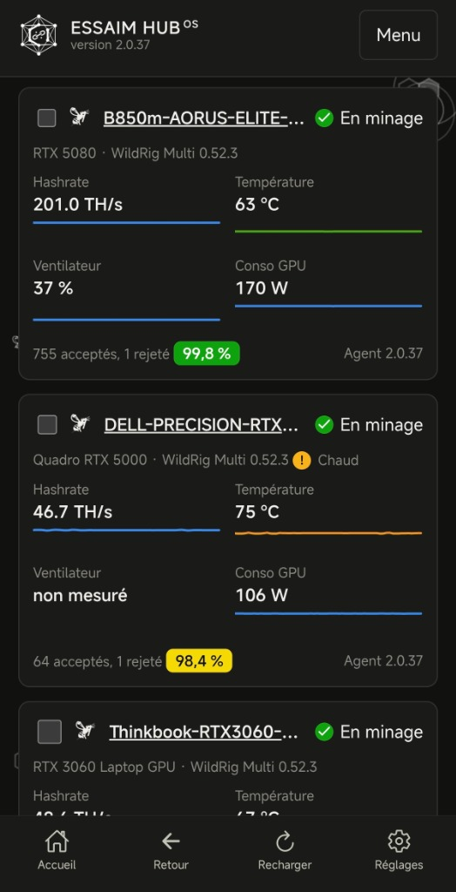

<div align="center">
  
  <h1>Essaim OS</h1>
  <p>
    <strong>Self-hosted GPU &amp; CPU mining OS and local fleet hub</strong><br />
    <em>Raspberry Pi · Docker · Bare-Metal Linux USB · Windows WSL2 · Android &amp; Telegram</em>
  </p>
  <p>
    <a href="https://essaimos.com/en"><strong>Website (essaimos.com)</strong></a> ·
    <a href="https://essaimos.com/en/demo"><strong>Live Demo (5-GPU Hub)</strong></a> ·
    <a href="https://essaimos.com/en/releases"><strong>Downloads &amp; Releases</strong></a> ·
    <a href="https://essaimos.com/en/docs"><strong>Installation Docs</strong></a> ·
    <a href="https://essaimos.com/en/smart-energy"><strong>World Electricity Tariffs</strong></a> ·
    <a href="https://essaimos.com/en/mobile-telegram"><strong>Mobile &amp; Telegram</strong></a> ·
    <a href="../../issues"><strong>Issues &amp; Support</strong></a>
  </p>
  <br />
  
</div>

---

## Why Essaim OS?

* **100% Local Fleet Control** — Run the Hub on a **Raspberry Pi**, **Docker**, a dedicated **x86 bare-metal USB/SSD** (`img.xz`), or a **Proxmox / QEMU VM** (`qcow2`). Zero cloud dependency: your farm keeps running if the internet goes down.
* **Plug-and-Play Workers** — Boot rigs from a **Linux USB stick** (`essaim.img.xz`) or run directly inside **Windows WSL2** (`essaim-agent.exe` + `essaim-wsl.tar.gz`) without wiping Windows.
* **GPU Auto-Tune & Mining Sandboxing** — Built-in GPU clock/power tuning, dual-mining & flight sheets, plus kernel-isolated sandboxing for custom third-party miners.
* **Global Electricity Tariffs (9 Currencies)** — Fixed kWh rate, 2-tier / 3-tier Time-of-Use presets (France HC/HP & EDF Tempo Blue/White/Red, Spain 2.0TD, UK Economy 7 & Octopus Go, US/CA/AU/CH TOU), live Spot APIs (`Octopus Agile`, `Red Eléctrica PVPC`, `aWATTar DE/AT`, `Tibber`), price-cap auto-pause & **Wake-on-LAN** resume.
* **Mobile App & Telegram Bot** — Monitor rigs, temperatures, profits and trigger start/stop/reboot remotely via Telegram commands or the Android app with embedded Tailscale (`tsnet`, no external VPN config needed).
* **Simple, Outage-Resilient Pricing** — **1st worker FREE forever** (no account required), then **$1 / month per additional active worker**, verified via signed offline-resilient **Ed25519** tokens (`essaimos.com/en/tarifs`).

<div align="center">
  
  &nbsp;&nbsp;&nbsp;
  
</div>

---

## Official Downloads & Verification (`v2.0.38`)

Download verified installers and disk images from [**essaimos.com/en/releases**](https://essaimos.com/en/releases):

| Artifact | Target | How to Run |
|---|---|---|
| `essaim-hub-2.0.38-docker-arm64.tar` | Raspberry Pi / ARM64 SBC | `docker load -i ...` + [`docker-compose.yml`](releases/2.0.38/docker-compose.yml) |
| `essaim-hub-2.0.38-docker-amd64.tar` | x86_64 Server / NAS / Docker | `docker load -i ...` + [`docker-compose.yml`](releases/2.0.38/docker-compose.yml) |
| `essaim-hub-2.0.38-amd64.img.xz` | Dedicated Mini-PC / Bare-Metal (UEFI & BIOS) | Flash with Rufus / balenaEtcher / Raspberry Pi Imager |
| `essaim-hub-2.0.38-amd64.qcow2` | QEMU / Proxmox VE | Import VM disk (`bridge` network to reach local rigs) |

Every release bundle includes the Linux worker image (`essaim.img.xz`), Windows WSL2 launcher (`essaim-agent.exe` + `essaim-wsl.tar.gz`), and Android companion APK (`essaim-mobile.apk`) served locally by your Hub once started (`http://<hub-ip>:8420`).

### Hub Hardware & Storage Requirements

| Resource | Minimum | Recommended | Notes |
|---|---|---|---|
| **CPU** | 1× 64-bit vCPU (`ARM64` or `x86_64`) | 2 cores | Raspberry Pi 3/4/5, Orange Pi, NAS, mini-PC, or Proxmox/QEMU VM (`< 2%` CPU usage in daily operation). |
| **RAM** | **512 MB** (128 MB free in Docker) | **1 GB** (dedicated mini-PC / VM) | The compiled Rust Hub process itself uses only **~20–30 MB** RAM (runs cleanly under Docker `--memory 96m`). |
| **Storage — Disk Image / VM (`.img.xz` / `.qcow2`)** | **8 GB** (strict minimum) | **16 GB** (32 GB comfortable) | ~1.7 GB used on first boot, plus headroom for 1-click worker image sync (`essaim.img.xz` ~1.15 GB + WSL/APK ~150 MB), NVIDIA/ROCm GPU driver cache (~400–600 MB per version), and SQLite history. VM resize: `qemu-img resize essaim-hub-<version>-amd64.qcow2 +12G`. |
| **Storage — Docker (Raspberry Pi / NAS / Linux)** | **4 GB free** (strict minimum) | **8–16 GB free** | ~1.3 GB `.tar` archive (removable after `docker load`), ~1.4 GB loaded Docker image, plus the `essaim-hub-data` volume (~1.3 GB synced worker images + ~0.5–1.5 GB GPU driver cache + temporary `.part` download headroom). |
| **Network** | Private LAN (TCP `8420`) | Wired Ethernet | Same LAN as workers (`network_mode: host` in Docker, `bridge` NIC on Proxmox/QEMU VMs). |

### Default Maintenance SSH Credentials (`.img.xz` / `.qcow2` & Bare-Metal Rigs)

* **Username**: `essaimos` (member of `sudo`)
* **Default password**: `essaimos-pass` (**mandatory change on first login** via console or SSH)
* **Security**: SSH is restricted to the local LAN (and Tailscale) and direct `root` SSH login is disabled (`PermitRootLogin no`). Daily management stays in the browser (`http://essaim-hub.local:8420`). On Docker installs, SSH belongs to the host OS.

### Checksums & Manifests

* [`releases/2.0.38/SHA256SUMS`](releases/2.0.38/SHA256SUMS) — Checksums for release `2.0.38`
* [`releases/2.0.38/VERSIONS.txt`](releases/2.0.38/VERSIONS.txt) — Component versions bundled in `2.0.38`
* Detached Ed25519 signature (`SHA256SUMS.sig`) and verification instructions are published on [**essaimos.com/en/releases**](https://essaimos.com/en/releases).

```bash
sha256sum -c SHA256SUMS
```

---

## Documentation & Live Demo (FR / EN / ES / DE)

* **Interactive Hub Live Demo (2× 5-GPU Linux Rigs + Windows WSL2)**: [essaimos.com/en/demo](https://essaimos.com/en/demo) ([FR: /demo](https://essaimos.com/demo) · [ES: /es/demo](https://essaimos.com/es/demo) · [DE: /de/demo](https://essaimos.com/de/demo))
* **Quick Install & Network Setup**: [essaimos.com/en/docs](https://essaimos.com/en/docs)
* **World Tariffs & Spot Simulator**: [essaimos.com/en/smart-energy](https://essaimos.com/en/smart-energy)
* **HiveOS Comparison**: [essaimos.com/en/compare](https://essaimos.com/en/compare)
* **Mobile App & Telegram Guide**: [essaimos.com/en/mobile-telegram](https://essaimos.com/en/mobile-telegram)
* **Ad Banners & Embeddable Media Kit**: [essaimos.com/en/banners](https://essaimos.com/en/banners) ([FR: essaimos.com/bannieres](https://essaimos.com/bannieres))

## Promo Banners & Media Kit ([`promo/`](promo/))

Want to link to or promote **Essaim OS** on a website, mining blog, forum, or social campaign? Use our hosted assets in [`promo/`](promo/) or copy ready-made HTML / Markdown / BBCode snippets from [**essaimos.com/en/banners**](https://essaimos.com/en/banners) ([FR](https://essaimos.com/bannieres)):

| Format | English (`-en`) | French (`-fr`) |
|---|---|---|
| **Fluid Animated Vector (960×176 SVG)** | [`essaim-banner-fluid-en.svg`](promo/essaim-banner-fluid-en.svg) | [`essaim-banner-fluid-fr.svg`](promo/essaim-banner-fluid-fr.svg) |
| **Leaderboard (728×90 PNG)** | [`essaim-banner-728x90-en.png`](promo/essaim-banner-728x90-en.png) | [`essaim-banner-728x90-fr.png`](promo/essaim-banner-728x90-fr.png) |
| **Medium Rectangle (300×250 PNG)** | [`essaim-banner-300x250-en.png`](promo/essaim-banner-300x250-en.png) | [`essaim-banner-300x250-fr.png`](promo/essaim-banner-300x250-fr.png) |
| **Social / Wide Display (1200×628 PNG)** | [`essaim-banner-1200x628-en.png`](promo/essaim-banner-1200x628-en.png) | [`essaim-banner-1200x628-fr.png`](promo/essaim-banner-1200x628-fr.png) |

```html
<a href="https://essaimos.com/en" target="_blank" rel="noopener">
  
</a>
```

<div align="center">
  
</div>

## Support & Bug Reports

Found a bug with a GPU driver, electricity tariff preset, or installer?
[Open an issue](../../issues/new/choose) and attach your hardware model, release version, and logs.

---

> *Note: This repository hosts public documentation, release manifests, and community issue tracking for **Essaim OS**. Official compiled binaries and disk images are distributed exclusively via [essaimos.com](https://essaimos.com).*
