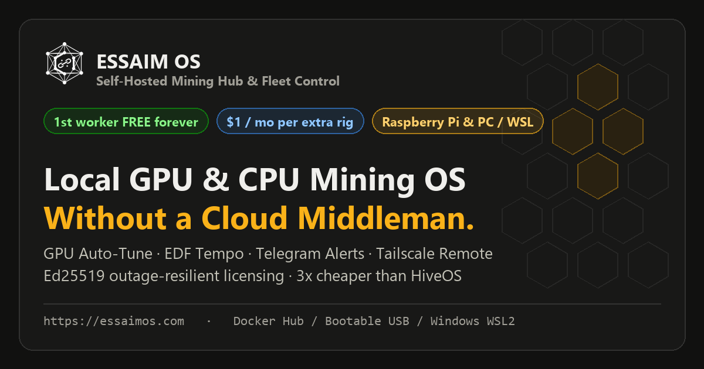
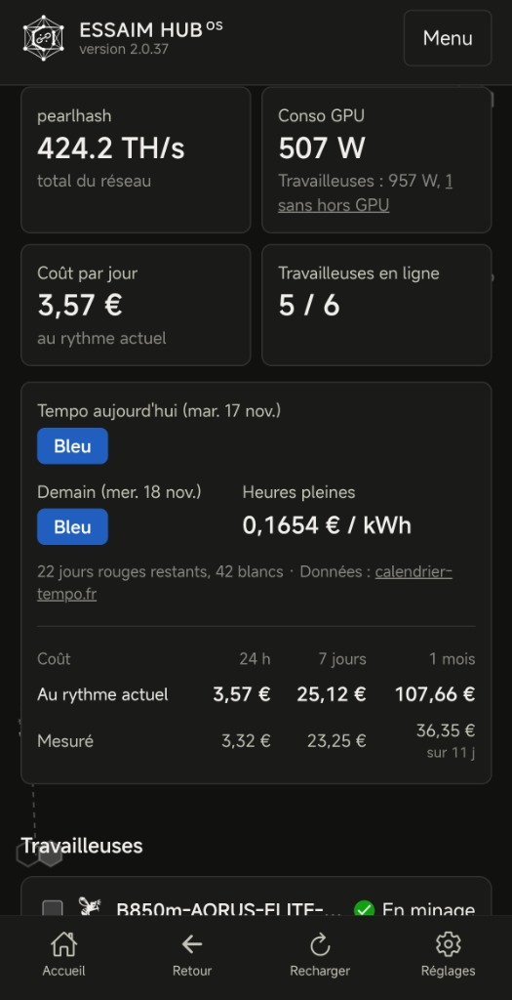

<div align="center">
  
  <h1>Essaim OS</h1>
  <p>
    <strong>Self-hosted GPU &amp; CPU mining OS and local fleet hub</strong><br />
    <em>OS de minage local auto-hébergé &amp; orchestrateur de flotte — Raspberry Pi, Linux USB, Windows WSL2 &amp; Android</em>
  </p>
  <p>
    <a href="https://essaimos.com"><strong>Website (essaimos.com)</strong></a> ·
    <a href="https://essaimos.com/releases"><strong>Downloads &amp; Releases</strong></a> ·
    <a href="https://essaimos.com/docs"><strong>Installation Docs</strong></a> ·
    <a href="https://essaimos.com/energie"><strong>World Electricity Tariffs</strong></a> ·
    <a href="https://essaimos.com/mobile-telegram"><strong>Mobile &amp; Telegram</strong></a> ·
    <a href="../../issues"><strong>Issues &amp; Support</strong></a>
  </p>
  <br />
  
</div>

---

## Why Essaim OS?

* **100% Local Fleet Control** — Run the Hub on a **Raspberry Pi**, **Docker**, a dedicated **x86 bare-metal USB/SSD** (`img.xz`), or a **Proxmox / QEMU VM** (`qcow2`). Zero cloud dependency: your farm keeps running if the internet goes down.
* **Plug-and-Play Workers** — Boot rigs from a **Linux USB stick** (`essaim.img.xz`) or run directly inside **Windows WSL2** (`essaim-agent.exe` + `essaim-wsl.tar.gz`) without wiping Windows.
* **GPU Auto-Tune & Mining Sandboxing** — Built-in GPU clock/power tuning, dual-mining & flight sheets, plus kernel-isolated sandboxing for custom third-party miners.
* **Global Electricity Tariffs (9 Currencies)** — Fixed kWh rate, 2-tier / 3-tier Time-of-Use presets (France HC/HP & EDF Tempo Blue/White/Red, Spain 2.0TD, UK Economy 7 & Octopus Go, US/CA/AU/CH TOU), live Spot APIs (`Octopus Agile`, `Red Eléctrica PVPC`, `aWATTar DE/AT`, `Tibber`), price-cap auto-pause & **Wake-on-LAN** resume.
* **Mobile App & Telegram Bot** — Monitor rigs, temperatures, profits and trigger start/stop/reboot remotely via Telegram commands or the Android app with embedded Tailscale (`tsnet`, no external VPN config needed).
* **Simple, Outage-Resilient Pricing** — **1st worker FREE forever** (no account required), then **$1 / month per additional active worker**, verified via signed offline-resilient **Ed25519** tokens (`essaimos.com/tarifs`).

<div align="center">
  
  &nbsp;&nbsp;&nbsp;
  
</div>

---

## Official Downloads & Verification (`v2.0.38`)

Download verified installers and disk images from [**essaimos.com/releases**](https://essaimos.com/releases):

| Artifact | Target | How to Run |
|---|---|---|
| `essaim-hub-2.0.38-docker-arm64.tar` | Raspberry Pi / ARM64 SBC | `docker load -i ...` + [`docker-compose.yml`](releases/2.0.38/docker-compose.yml) |
| `essaim-hub-2.0.38-docker-amd64.tar` | x86_64 Server / NAS / Docker | `docker load -i ...` + [`docker-compose.yml`](releases/2.0.38/docker-compose.yml) |
| `essaim-hub-2.0.38-amd64.img.xz` | Dedicated Mini-PC / Bare-Metal (UEFI & BIOS) | Flash with Rufus / balenaEtcher / Raspberry Pi Imager |
| `essaim-hub-2.0.38-amd64.qcow2` | QEMU / Proxmox VE | Import VM disk (`bridge` network to reach local rigs) |

Every release bundle includes the Linux worker image (`essaim.img.xz`), Windows WSL2 launcher (`essaim-agent.exe` + `essaim-wsl.tar.gz`), and Android companion APK (`essaim-mobile.apk`) served locally by your Hub once started (`http://<hub-ip>:8420`).

### Checksums & Manifests

* [`releases/2.0.38/SHA256SUMS`](releases/2.0.38/SHA256SUMS) — Checksums for release `2.0.38`
* [`releases/2.0.38/VERSIONS.txt`](releases/2.0.38/VERSIONS.txt) — Component versions bundled in `2.0.38`
* Detached Ed25519 signature (`SHA256SUMS.sig`) and verification instructions are published on [**essaimos.com/releases**](https://essaimos.com/releases).

```bash
sha256sum -c SHA256SUMS
```

---

## Documentation (FR / EN / ES / DE)

* **Quick Install & Network Setup**: [essaimos.com/docs](https://essaimos.com/docs)
* **World Tariffs & Spot Simulator**: [essaimos.com/energie](https://essaimos.com/energie)
* **HiveOS Comparison**: [essaimos.com/comparatif](https://essaimos.com/comparatif)
* **Mobile App & Telegram Guide**: [essaimos.com/mobile-telegram](https://essaimos.com/mobile-telegram)

## Support & Bug Reports

Found a bug with a GPU driver, electricity tariff preset, or installer?
[Open an issue](../../issues/new/choose) and attach your hardware model, release version, and logs.

---

> *Note: This repository hosts public documentation, release manifests, and community issue tracking for **Essaim OS**. Official compiled binaries and disk images are distributed exclusively via [essaimos.com](https://essaimos.com).*
