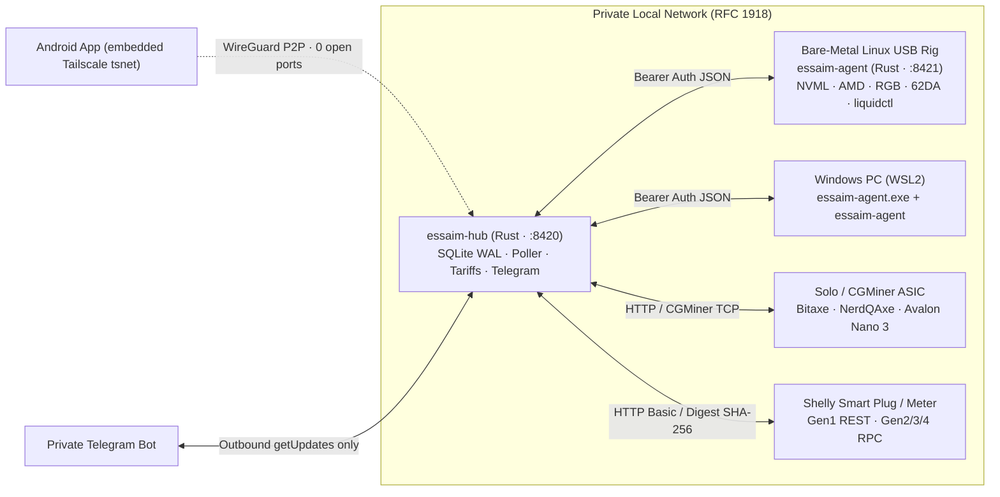

# System Architecture — Essaim OS

Technical overview of how **Essaim Hub**, **Essaim Agent**, **SQLite WAL storage**, **Ed25519 licensing**, and **remote access** work together on a local network.

---

## High-Level Topology

---

## Core Components

### 1. `essaim-hub` (Local Fleet Orchestrator, Rust + Axum + SQLite WAL)
- **Single compiled binary** serving both the REST API (`/api/*`) and the embedded zero-dependency SPA web interface on TCP `:8420`.
- **SD-Card-Friendly SQLite WAL**: Every polling cycle batches all worker metrics, Shelly wall-power readings (`wall_power`, `wall_energy_wh`), workload histories, and events into **one single SQLite transaction**, with gapless 5-minute rollups (`samples_5m`, 90-day retention) and 1-click full `.db` backup & verified restore.
- **Smart Energy Engine**: Evaluates fixed rates, HC/HP, global 2/3-tier TOU, France EDF Tempo, and live Spot APIs (`Octopus Agile`, `REE PVPC`, `aWATTar`, `Tibber`) hour-by-hour against recorded wall/GPU energy, triggering automatic pause, Wake-on-LAN, or Shelly relay wake-up.
- **Zero-Touch Reflash Relink**: Recognizes reflashed USB worker keys by IP or MAC and lets operators re-associate them without losing historical charts, overclock profiles, schedules, or Shelly bindings.

### 2. `essaim-agent` (Worker Daemon, Rust)
- Runs on bare-metal minimal Debian USB rigs (`:8421`) and Windows WSL2 workers.
- **Multi-Workload Profiles**: Up to 4 concurrent workloads per rig (GPU dual/split mining + CPU mining), indexed consistently by `CUDA_DEVICE_ORDER=PCI_BUS_ID`.
- **10-Minute Supervised OC Trial & Per-GPU Rollback**: When tuning changes only card OC settings, a failing card (NVIDIA Xid, stuck GPU, miner crash, or >10% hashrate loss) rolls back individually while healthy GPUs continue mining uninterrupted.
- **Chained GPU Auto-Tune**: Automatically sweeps core clocks, offsets, and power limits card-by-card for `balanced`, `eco`, or `max` objectives and saves named OC profiles directly to the Hub.
- **Hot GPU Driver Switching**: Dedicated systemd unit (`essaim-driver-switch`) swaps precompiled NVIDIA open kernel modules or AMD ROCm OpenCL packages fetched and SHA-256-verified by the Hub, with 10-minute stability validation and automatic rollback.
- **Custom Miner Sandbox**: Third-party miners run in isolated Linux namespaces with `nftables` blocking private LAN and loopback targets.
- **Native Hardware Chassis Loop**: Direct Rust control of PWM case fans, RGB controllers (Gigabyte/AORUS RTX 50 `I2C 0x75`, ITE `IT5711`, Wraith Prism, ASUS Aura, `/sys/class/leds`), XPG 62DA displays (`125f:7601`), and zero-overhead sysfs-gated `liquidctl` AIO bridge.

### 3. Resilient Ed25519 Licensing & Signed OTA
- The 1st GPU/CPU worker per Hub and micro Solo ASICs run free with no account.
- Paid Worker-Day packs issue **Ed25519-signed tokens** bound to the Hub's hardware `box_id`, valid offline for **10 days** during internet outages.
- Hub and agent OTA updates verify Ed25519 manifests and SHA-256 checksums before applying, with automatic rollback if the updated binary fails health checks.
